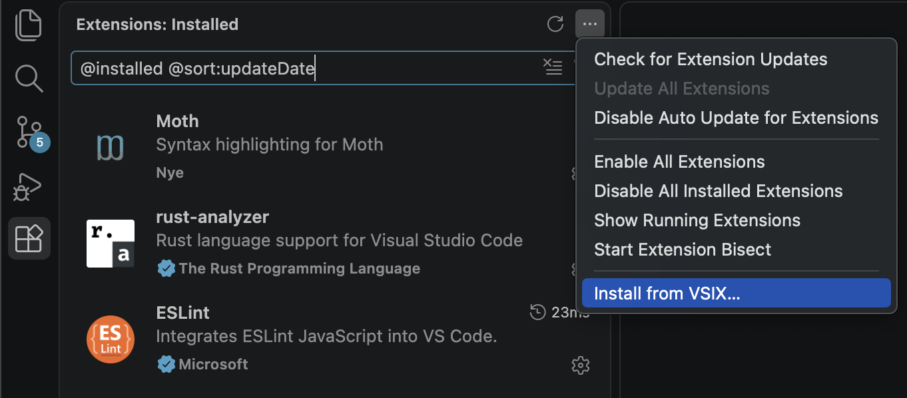

# Moth VS Code Syntax Highlighting

Language support and syntax highlighting for Moth (`.moth`) and Moth Template
(`.mtf`) files.

The grammars cover current Moth syntax: exact-width numeric types, mutable and
const declarations, never/fallible calls, dependency clauses, templates, slots,
formatters, Moth Markdown, and embedded Moth/CSS/HTML/JS/TS/Python/Rust/Shell
code. `.mtf` files start in the implicit `$md` body, and nested `.mtf` templates
without an explicit formatter also default to Markdown.

The maintenance map, scope conventions, retired forms, and TextMate limits are
in [`docs/syntax-inventory.md`](docs/syntax-inventory.md).

## Installing

Download the `moth-highligher-*.vsix` file, go to VS Code extensions and select
"install from VSIX...", then install this file.

If you don't trust it (which is reasonable): package this plugin yourself using
`vsce package` to generate the vsix file.



The package identifier `moth-highligher` is intentionally retained for upgrade
compatibility. It is not renamed by this syntax update.

## Known limits

This extension uses TextMate grammars only. It does not provide semantic
language-server support or compiler diagnostics. TextMate cannot enforce
source-directive attachment, template-line uniqueness rules, or semantic slot
targets; those remain compiler responsibilities.

Exact limitations and reproducible samples are recorded in
[`docs/syntax-inventory.md`](docs/syntax-inventory.md#known-textmate-limits).
In particular:

- A multiline Markdown link label requires exactly one physical line break. A
  target followed by a second break keeps its link colour even though the label
  does not associate.
- A parent inline-code span that crosses a child template is rejected by the
  compiler; TextMate cannot detect that ordering.
- File icons are registered per language. The optional **Moth File Icons**
  theme adds exact-filename tints for `@entry.moth`, `@mod.moth`, and
  `@package.moth`; unmatched files and folders use the default brown logo.
  Select it with **Preferences: File Icon Theme**.

## Development

Install dependencies and run the test suite:

```bash
npm ci
npm test
```

The suite uses `vscode-textmate` and `vscode-oniguruma`, the same libraries VS
Code uses for grammar tokenisation. It verifies token scopes, ranges, multiline
rule-stack transitions, nested templates, Markdown, dependency clauses, and
embedded-language boundaries in both `.moth` and `.mtf` files.

Inspect the packaged extension contents without publishing:

```bash
npm pack --dry-run
```

Package the VSIX with the documented Visual Studio Code extension tooling:

```bash
npx @vscode/vsce package
```
